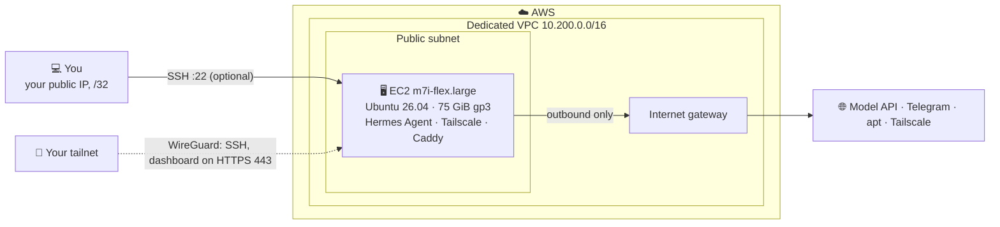

<div align="center">

# Hermes on AWS, in one `tofu apply`

**A locked-down, single-instance home for [Hermes Agent](https://github.com/NousResearch/hermes-agent):<br/>an always-on AI agent you can message from your phone.**


[Quick start](#quick-start) ·
[Architecture](#architecture) ·
[Set up Hermes](#set-up-hermes) ·
[Tailscale](#tailscale-and-locking-ssh-down) ·
[Dashboard](#hermes-dashboard-on-your-tailnet) ·
[Configuration](#configuration) ·
[Security](#security-model) ·
[Troubleshooting](#troubleshooting)

</div>

---

## What you get

One `tofu apply` gives you a ready-to-configure box, with no clicking around the console:

| | |
|---|---|
| **Hermes Agent**, pre-installed | Installed for the `ubuntu` user with the official installer in non-interactive mode. Installed, **not configured**: you choose the provider, model and chat platform, from the dashboard or the CLI (see [Set up Hermes](#set-up-hermes)). |
| **Tailscale**, pre-installed | Joins your tailnet at first boot if you pass an auth key; otherwise installed and waiting for one `tailscale up`. Either way you can close public SSH entirely. |
| **Hermes dashboard on your tailnet** | Caddy publishes Hermes's built-in web dashboard (sessions, usage and costs, logs, cron, config) over HTTPS **on your tailnet only**, behind Hermes's own login. No inbound port is opened for it. See [Hermes dashboard on your tailnet](#hermes-dashboard-on-your-tailnet). |
| **A dedicated VPC** | One public subnet, an internet gateway, a route table. Works in accounts that have no default VPC. **No NAT gateway**, so nothing expensive hiding in the bill. |
| **At most one inbound rule** | SSH (TCP 22) from the public IP of the machine running `tofu`, as a single `/32`. Or none at all, if you join the tailnet with an auth key and switch it off. |
| **Sensible host hardening** | IMDSv2 only, encrypted gp3 root volume, and no IAM role, so there are no AWS credentials on the box to steal. |

> [!NOTE]
> Defaults: Ubuntu 26.04 LTS, `m7i-flex.large` (2 vCPU / 8 GiB), 75 GiB gp3, region `eu-central-1`. All overridable, see [Configuration](#configuration).

## Architecture



Hermes only makes **outbound** connections (to your model provider and to chat platforms; Telegram uses long polling by default), so the security group needs no inbound rule for it. Tailscale traffic arrives through the WireGuard tunnel the node opens outbound, so the dashboard needs no security group rule either.

<details>
<summary><b>Resources created (10)</b></summary>

| Resource | Purpose |
|---|---|
| `aws_vpc` | Dedicated VPC (`10.200.0.0/16`) |
| `aws_subnet` | One public `/24`, in an AZ that offers the instance type |
| `aws_internet_gateway` | Outbound internet, free |
| `aws_route_table` + `aws_route_table_association` | Default route `0.0.0.0/0` to the internet gateway |
| `aws_security_group` | Attached to the instance |
| `aws_vpc_security_group_egress_rule` | Allow all outbound |
| `aws_vpc_security_group_ingress_rule` | **The only inbound rule:** TCP 22 from your `/32` (absent when `ssh_allow_current_ip = false`, giving 9) |
| `aws_key_pair` | From the public key you supply |
| `aws_instance` | The Hermes box, with the first-boot bootstrap as `user_data` |

The dashboard, Caddy and Tailscale add no AWS resources: they are software on the instance.

</details>

## Prerequisites

- [OpenTofu](https://opentofu.org) 1.6 or newer
- AWS credentials for the target account (an SSO or named profile is fine)
- An SSH key pair; only the **public** key is given to AWS
- Optional, for the tailnet features: a [Tailscale](https://tailscale.com) account with **MagicDNS** and **HTTPS certificates** enabled (DNS page of the admin console)

## Quick start

```sh
# 1. Point at the right AWS account, and check you are in it
export AWS_PROFILE=<your-profile>
aws sts get-caller-identity

# 2. Hand OpenTofu your SSH *public* key through the environment
export TF_VAR_ssh_public_key="$(cat ~/.ssh/id_ed25519.pub)"

# 3. Plan, read it, apply
tofu init
tofu plan -out=tfplan
tofu apply tfplan
```

A healthy plan shows **10 to add**: exactly one SSH ingress rule, no IAM resources, no NAT gateway.

> [!TIP]
> Prefer files over environment variables? Copy `terraform.tfvars.example` to `terraform.tfvars` (git-ignored) and fill it in. Values in `terraform.tfvars` win over `TF_VAR_*` variables.

> [!IMPORTANT]
> The security group opens SSH to the IP the plan was made from. If you change network (home, office, VPN on/off), run `tofu apply` again from the new network to update the rule.

### Tailnet-only: join at first boot and never open SSH

Give OpenTofu a Tailscale auth key and the box joins your tailnet by itself, so port 22 can stay closed from the very first minute:

```sh
export TF_VAR_tailscale_auth_key='tskey-auth-...'     # a one-off key, see below
export TF_VAR_ssh_allow_current_ip=false              # no inbound rules at all
export TF_VAR_tailnet_domain='<your-tailnet>.ts.net'  # optional: only used for the dashboard_url output
export TF_VAR_ssh_public_key="$(cat ~/.ssh/id_ed25519.pub)"   # keep this: break-glass access

tofu plan -out=tfplan && tofu apply tfplan
```

A few minutes after the apply, the node shows up in your tailnet as `hermes`, and from any device on it:

```sh
ssh ubuntu@hermes          # Tailscale SSH: no key, no open port
```

**Create the key** in the Tailscale admin console (Settings, Keys, *Generate auth key*):

| Option | Choose | Why |
|---|---|---|
| **Reusable** | off (one-off) | A one-off key is revoked automatically after the first use, so a leaked copy is worthless afterwards. |
| **Expiration** | 1 day | The key is only needed during the first boot. |
| **Ephemeral** | off | An ephemeral node is deleted when it goes offline, for example when you stop the instance. |
| **Pre-approved** | on, if your tailnet requires device approval | Otherwise the node waits for you to approve it. |

> [!WARNING]
> The key is a secret, and `user_data` is not a secure channel. It ends up in the OpenTofu **state**, in a saved **plan file** (`tfplan`, git-ignored) and in the instance's **user-data**, which any process on the box can read through the metadata service. That is why a one-off, short-lived key is the right kind: by the time anyone could read it, it is already spent. The variable is marked `sensitive`, so it never prints in plan output.

> [!NOTE]
> **Tags and ACLs.** A key created with tags tags the node and disables its key expiry, but Tailscale's *default* SSH rule only covers devices owned by a user, so a tagged node needs an `ssh` rule in your tailnet policy. An untagged key makes the node yours (the default rule applies), but its node key then expires after 180 days unless you disable expiry for it in the admin console.

## Connect

```sh
tofu output ssh_command                 # prints: ssh ubuntu@<public_ip>   (null when SSH is closed)
ssh -i ~/.ssh/id_ed25519 ubuntu@<public_ip>
```

The first boot installs packages for a few minutes. Watch it with:

```sh
cloud-init status --wait
tail -f /var/log/cloud-init-output.log
```

## Set up Hermes

Hermes is installed but unconfigured. It needs two things before it can answer anything: a **model provider with its API key** (for example OpenCode), and optionally a **chat platform** (for example Telegram). Nothing in this repo asks for those keys: they are long-lived secrets, so they stay out of the OpenTofu state, saved plans and user-data. You enter them once, either way below.

### Option A: from the dashboard (recommended)

Needs the [dashboard](#hermes-dashboard-on-your-tailnet) to be up. This follows Hermes's own documentation of its dashboard; the exact page layout may differ between Hermes versions.

1. **Open the dashboard and log in.** The URL is `tofu output dashboard_url` (set `tailnet_domain` for it to be filled in, otherwise it is `https://<name>.<your-tailnet>.ts.net`). The login is:

   ```sh
   tofu output dashboard_username
   tofu output -raw dashboard_password
   ```

2. **Config page, `model` section:** choose the provider (`opencode-go` for the OpenCode Go plan, `opencode-zen` for Zen) and the default model. Use a model ID that your plan actually offers; check the provider's model list rather than guessing one.
3. **API Keys page, LLM providers:** enter the OpenCode key (`OPENCODE_GO_API_KEY` for Go, `OPENCODE_ZEN_API_KEY` for Zen). If your provider is not listed there, set it from a terminal on the box instead: `hermes config set OPENCODE_GO_API_KEY <key>` (it is written to `~/.hermes/.env`).
4. **Create the Telegram bot** on your phone: open `@BotFather` in Telegram, send `/newbot`, pick a name and a username, and copy the token. A phone number is never given to Hermes; the bot token is the credential. Get your own numeric user ID from `@userinfobot`.
5. **Channels page, Telegram:** paste the token, put **your numeric user ID in the allowed users**, enable the channel, run the connection test, then use the restart button so the gateway picks it up.
6. **Make the gateway survive reboots and logouts.** On the box, run `hermes gateway install`, then `hermes gateway status`. If the gateway stops when you disconnect, run `sudo loginctl enable-linger ubuntu` (Hermes tries to enable that itself).
7. **Say hello to your bot.** Check **Status**, **Sessions** and **Logs** in the dashboard if it stays silent.

### Option B: from the command line

On the box, as the `ubuntu` user (a fresh login shell, so `hermes` is on your `PATH`):

```sh
hermes setup             # provider, model, API key
hermes gateway setup     # connect a chat platform
hermes gateway install   # run the gateway as a service, so it survives logout
```

Then just run `hermes` in a project directory to chat in the terminal.

> [!WARNING]
> Always set a **user allowlist** for your chat platform (for Telegram, `TELEGRAM_ALLOWED_USERS=<your numeric user id>`). The agent has a terminal on this machine. Hermes denies unlisted users by default; never override that.

**Telegram notes**
- Messages arrive by **long polling** (the default), which is outbound-only. Do not enable webhook mode; it needs an inbound HTTPS port that this security group does not open.
- Telegram cloud chats, which bots use, are **not end-to-end encrypted**; Secret Chats are, but a bot cannot use them. Keep API keys and secrets out of chat and enter them over SSH. Hermes also supports Signal, which is end-to-end encrypted but needs a phone number and `signal-cli`.

## Tailscale and locking SSH down

**With an auth key** (see [Tailnet-only](#tailnet-only-join-at-first-boot-and-never-open-ssh)) the node has already joined; there is nothing to do here. Check with `tailscale status` on the box.

**Without one**, Tailscale is installed and its daemon runs, but the node is **not joined**. Join once, interactively:

```sh
sudo tailscale up --ssh --hostname=hermes     # `tofu output tailscale_up_command` prints this
```

Open the printed URL to approve the node. `--hostname` should match the `name` variable (default `hermes`): it fixes the node's tailnet name, which the [dashboard](#hermes-dashboard-on-your-tailnet) URL is built from.

**Then close public SSH completely**, so the security group has **no inbound rules at all**:

1. **Test first** from another device on your tailnet, using the node's tailnet name (`tailscale status`) or its `100.x` address (`tailscale ip -4` on the instance):

   ```sh
   ssh ubuntu@<tailnet-name-or-100.x-address>
   ```

2. **Only when that works**, set `ssh_allow_current_ip = false` in `terraform.tfvars`.
3. `tofu plan -out=tfplan` should show exactly one change (the SSH rule being destroyed). Then `tofu apply tfplan`.
4. **Check** from a machine outside your tailnet: `ssh ubuntu@<public_ip>` should now time out; the tailnet address still works.

> [!CAUTION]
> There is no SSM Session Manager and no other way in. If Tailscale is down and public SSH is closed, you are locked out. Recovery is easy and needs no access to the box: set `ssh_allow_current_ip = true` again and run `tofu apply` from the machine you want to SSH from. That only works if the instance has a key pair attached, which is why you should **always keep `ssh_public_key` set**, even in tailnet-only mode: adding a key pair later means replacing the instance.

## Hermes dashboard on your tailnet

Hermes ships a web dashboard: sessions with full-text search, token usage and costs per model, logs, cron jobs, config and API keys, and an embedded terminal. It listens on `127.0.0.1:9119` only. **Caddy** publishes it on your tailnet name over HTTPS, using the certificate Tailscale issues for that name.

```
https://hermes.<your-tailnet>.ts.net   ->   Caddy :443   ->   hermes dashboard 127.0.0.1:9119
   (only devices on your tailnet)          (WireGuard)         (login generated by OpenTofu)
```

**Prerequisites:** MagicDNS and HTTPS certificates enabled on the DNS page of the Tailscale admin console.

**How it gets wired**, depending on what you gave OpenTofu:

| You set | What happens |
|---|---|
| `tailscale_auth_key` | The node joins at first boot, then reads its real tailnet name and wires the dashboard. Nothing to do. |
| `tailnet_domain` only | The dashboard is wired at first boot for `<name>.<tailnet_domain>`. Then you join with `sudo tailscale up --ssh --hostname=<name>`. |
| neither | After joining, run `sudo hermes-dashboard-setup` once. It reads the real name from Tailscale. |

**Log in.** OpenTofu generates the login for you (so a headless setup never needs a login to the box to find it), and you read it on the machine you ran `tofu` from:

```sh
tofu output dashboard_username          # for example: happy-otter       (two random words)
tofu output -raw dashboard_password     # for example: 14-quietly-happy-otter!   (number, words, "!")
```

To choose your own instead, set `dashboard_username` and/or `dashboard_password` (`TF_VAR_dashboard_password`). Any passphrase generator works, for example Crypt::HSXKPasswd or `openssl rand -hex 16`; the password may be any 16-128 printable ASCII characters, symbols and spaces included.

> [!NOTE]
> **How strong is the generated password?** It is a two-digit number plus dictionary words, about **30-35 bits at the default of 3 words**: fine against casual guessing on a tailnet-only login, thin for something that opens a terminal on this machine. Raise `dashboard_password_words` to 6 or more (each extra word adds roughly 9-10 bits), or set your own password.
>
> The login is seeded onto the instance **once, at first boot**, and stored there in a root-only file (`/etc/hermes-dashboard/dashboard.env`). If you change the password on the instance later, `tofu output` is stale.

**Why it works this way**
- Hermes validates the `Host` header (DNS-rebinding protection), and on a loopback bind only accepts `localhost`. Pointing a proxy at it with the tailnet name would be refused. The supported fix is to declare the public URL (`HERMES_DASHBOARD_PUBLIC_URL`), which makes Hermes trust that exact host **and turns on its own login**, so the dashboard is never open.
- Caddy must **not** rewrite `Host` or `Origin` to `127.0.0.1` to get around this: that would disable the WebSocket origin check that protects the embedded terminal.
- The tailnet name only exists after the node has joined, hence the helper script (`hermes-dashboard-setup`) and the `tailnet_domain` shortcut.

> [!WARNING]
> The dashboard can edit config, manage API keys and open a terminal on this machine. Three layers protect it: the security group has no rule for it, only devices on your tailnet can reach it, and Hermes requires a login. Do not weaken any of them, and do not share the box to other users on your tailnet without checking your tailnet policy.

Set `enable_tailnet_dashboard = false` to skip Caddy and all of this.

## Configuration

Set variables with `terraform.tfvars`, `-var`, or `TF_VAR_<name>` environment variables.

| Variable | Default | Description |
|---|---|---|
| `region` | `eu-central-1` | AWS region |
| `aws_profile` | `null` | AWS profile; `null` uses the default credential chain (`AWS_PROFILE`) |
| `name` | `hermes` | Name prefix for all resources, and the node's hostname in your tailnet (a lowercase DNS label) |
| `instance_type` | `m7i-flex.large` | EC2 instance type |
| `root_volume_size_gb` | `75` | Root volume size (GiB, encrypted gp3) |
| `ubuntu_version` | `26.04` | Ubuntu LTS release; use `24.04` if a dependency does not support 26.04 yet |
| `vpc_cidr` | `10.200.0.0/16` | CIDR of the VPC this creates; the subnet is its first `/24` |
| `ssh_allow_current_ip` | `true` | Open SSH to the IP `tofu` runs from; `false` removes all inbound rules |
| `ssh_public_key` | `null` | Public key to register as an EC2 key pair (login user: `ubuntu`). Keep it set as break-glass access. |
| `ssh_key_name` | `null` | Alternative to `ssh_public_key`: name of an existing key pair |
| `tailscale_auth_key` | `null` | **Secret, sensitive.** Join the tailnet at first boot. Use a one-off, 1-day key; pass as `TF_VAR_tailscale_auth_key` |
| `tailnet_domain` | `null` | Your `<tailnet>.ts.net`. Lets the dashboard be wired before you join, and fills the `dashboard_url` output. Identifying, so keep it in your git-ignored `terraform.tfvars` |
| `dashboard_username` | `null` | Dashboard login name. `null` generates two random words, for example `happy-otter` |
| `dashboard_password` | `null` | **Secret, sensitive.** Dashboard password, 16-128 printable ASCII characters. `null` generates one like `14-quietly-happy-otter!` |
| `dashboard_password_words` | `3` | Words in the generated password (3-10). About 30-35 bits at 3; use 6+ for a stronger one |
| `enable_tailnet_dashboard` | `true` | Install Caddy and the dashboard helper. Nothing starts or is exposed until the node has a tailnet name |
| `user_data` | `null` | Extra shell snippet appended after the built-in bootstrap |
| `tags` | `Project`, `Environment`, `ManagedBy` | Tags applied to every resource |

**Outputs:** `instance_id`, `public_ip`, `ami_id`, `ssh_command`, `tailscale_up_command`, `dashboard_url`, `dashboard_username`, `dashboard_password` (sensitive: `tofu output -raw dashboard_password`).

<details>
<summary><b>What the first-boot bootstrap does</b></summary>

Runs once through cloud-init as root (`files/bootstrap.sh.tftpl`), in this order, so a later failure cannot block an earlier step:

1. `apt-get install` of `ca-certificates curl git gnupg jq libatomic1 openssl tar` (the installers need them; minimal Ubuntu images lack `libatomic1`)
2. Adds Tailscale's official apt repository for the running Ubuntu codename and installs `tailscale`. With `tailscale_auth_key` set, joins the tailnet (`--ssh --hostname=<name>`), passing the key through a root-only tmpfs file and deleting it right after.
3. Downloads the Hermes installer and runs it as `ubuntu` with `--non-interactive`, which skips the setup wizard and the gateway service install. A failure is remembered and reported at the very end.
4. With `enable_tailnet_dashboard`: adds Caddy's official apt repository and installs `caddy` (kept stopped), installs the `hermes-dashboard.service` unit and the `hermes-dashboard-setup` helper, writes the dashboard login into a root-only env file (the password travels base64-encoded, so symbols cannot be misread by the shell), and runs the helper if the tailnet name is already known.

Your own `user_data`, if set, is appended after these steps. `user_data` is **ignored after the instance exists** (cloud-init runs it once); to run a changed version, use `tofu apply -replace=aws_instance.this`.

</details>

## Security model

| Layer | Control |
|---|---|
| **Network** | At most one inbound rule: TCP 22 from a single `/32`, looked up at plan time. A postcondition refuses anything that is not a public IPv4 address. All outbound allowed; no other inbound, ever. Nothing in this config opens 80, 443 or 9119. |
| **Host** | IMDSv2 required, encrypted root volume, **no IAM role or instance profile** (no AWS credentials on the box, no SSM). |
| **Access** | Key-pair SSH as `ubuntu`, or Tailscale SSH once joined, then optionally closing public SSH entirely. |
| **Dashboard** | Reachable only through your tailnet, over HTTPS, behind Hermes's own login (generated by OpenTofu, or yours; stored root-only on the box). The dashboard process itself listens on loopback only. |
| **Auth key** | `sensitive` variable, one-off and short-lived by design, written to a root-only tmpfs file (never a command-line argument) and deleted after use. |
| **Agent** | Hermes denies unlisted chat users by default; dangerous commands need approval (`approvals.mode`), and unattended runs default to deny. |

**Known limitations**
- **Local state.** `terraform.tfstate` stays on your machine (git-ignored) and contains the auth key if you used one. Add a remote backend with encryption before using this beyond a personal sandbox.
- **The model key and chat bot are set up by hand, once.** Rebuilding the instance means doing [Set up Hermes](#set-up-hermes) again. That is deliberate: the OpenCode key and bot token are long-lived secrets, and this keeps them out of the OpenTofu state and the instance's user-data.
- **Unpinned installers.** Hermes, Tailscale's and Caddy's repositories are fetched at first boot, so you get whatever is current.
- **Public IP is not fixed.** It changes when the instance is stopped and started. Attach an Elastic IP if you need it stable (not needed for tailnet access).
- **Prompts leave AWS.** Whatever you send the agent goes to your chosen model provider and chat platform.
- **Dashboard login is one shared account**, with a password that is in the state file. Real per-user access control would need Hermes's OAuth or OIDC providers.

## Costs

Money is spent on the **EC2 instance** (the big one), the **75 GiB volume**, and the **public IPv4 address**. The VPC, subnet, internet gateway, route table and security group are free, and there is **no NAT gateway**. Check current prices for your region before leaving it running.

## Day-2 operations

| Task | How |
|---|---|
| **My IP changed** | Run `tofu apply` again from the new network. (Not an issue once SSH is closed and you use the tailnet.) |
| **Bigger instance** | Change `instance_type` and apply. The instance stops and starts, and the public IP changes. |
| **Bigger disk** | Raise `root_volume_size_gb` and apply (volumes can grow, never shrink). Reboot so cloud-init grows the filesystem, then check with `df -h`. |
| **Switch Ubuntu release** | Changing `ubuntu_version` does not replace a running instance (the AMI is ignored after creation). Recreate with `tofu apply -replace=aws_instance.this` (this wipes the disk, so back up anything you need first). |
| **Re-run the first-boot script** | Same: `tofu apply -replace=aws_instance.this`. Editing `user_data` or the auth key on a running instance has no effect. For a new tailnet join without replacing, run `sudo tailscale up --ssh --hostname=hermes` by hand. |
| **Rotate the dashboard password** | Edit `/etc/hermes-dashboard/dashboard.env` on the instance (keep the double quotes around the password) and `sudo systemctl restart hermes-dashboard`. Changing it in OpenTofu does not reach a running instance, and `tofu output` then shows the old value. |
| **Forgot the dashboard login** | `tofu output dashboard_username` and `tofu output -raw dashboard_password` on the machine that holds the state. |
| **Tear it all down** | `tofu destroy`. This deletes the instance **and its disk**, including all Hermes memory, sessions and config. Remove the node from your tailnet in the admin console too. |

## Troubleshooting

| Symptom | Likely cause and fix |
|---|---|
| `ExpiredToken` or `profile could not be found` | AWS credentials expired or the profile name changed. Refresh them, then check `aws sts get-caller-identity`. |
| Plan fails: *no key to log in with* | Set `TF_VAR_ssh_public_key` (or `ssh_public_key`, or `ssh_key_name`). |
| Plan warns: *SSH is closed and no key pair is attached* | Keep `ssh_public_key` set so you have break-glass access. |
| Plan fails: *did not return a public IPv4 address* | The IP lookup returned IPv6 or something odd (some VPNs and proxies). Try another network, or use the tailnet-only setup and set `ssh_allow_current_ip = false`. |
| Plan fails: *No availability zone … offers* | The instance type is not offered in the region. Pick another `instance_type` or `region`. |
| Plan fails: *does not look like a Tailscale auth key* | The key must start with `tskey-`. The value is deliberately not printed. |
| Node never appears in the tailnet | The key was expired, already used, or not pre-approved. See `/var/log/cloud-init-output.log` (`tailscale up failed`). SSH in (if the rule is open) and run `sudo tailscale up --ssh --hostname=hermes`. |
| SSH times out | Your public IP changed: run `tofu apply` again from where you are. Or the bootstrap is still running. |
| `hermes: command not found` | Open a new login shell; the installer edits your shell rc files. |
| Dashboard URL does not load | `sudo systemctl status hermes-dashboard caddy`, then `journalctl -u hermes-dashboard -n 50` and `journalctl -u caddy -n 50`. Are you on the tailnet, with HTTPS certificates enabled in the admin console? |
| Dashboard says *invalid host* or loops on login | The tailnet name differs from the one the dashboard was wired for (for example `hermes-1` after a name clash). Run `sudo hermes-dashboard-setup` to re-read the real name. |
| Bootstrap seems to have failed | `cloud-init status --long` and `/var/log/cloud-init-output.log`. If a package or installer does not support Ubuntu 26.04 yet, set `ubuntu_version = "24.04"`. |
| Bot does not reply | Is the gateway running (`hermes gateway start`)? Is your numeric user id in the allowlist? Is webhook mode accidentally enabled? |

## Project layout

| File | Contents |
|---|---|
| `versions.tf` | OpenTofu and provider versions, AWS provider config |
| `variables.tf` | All inputs, with validation |
| `main.tf` | VPC, security group, key pair, instance, bootstrap wiring, checks |
| `outputs.tf` | Instance ID, public IP, AMI, SSH command, join command, dashboard URL |
| `files/bootstrap.sh.tftpl` | The first-boot script (templated) |
| `files/hermes-dashboard-setup.sh` | Helper installed on the box: wires the dashboard to the tailnet name |
| `files/hermes-dashboard.service` | systemd unit for the loopback-only Hermes dashboard |
| `terraform.tfvars.example` | Template for your local `terraform.tfvars` (git-ignored) |
| `.terraform.lock.hcl` | Pinned provider versions; commit it |

## License

See [LICENSE](LICENSE).
