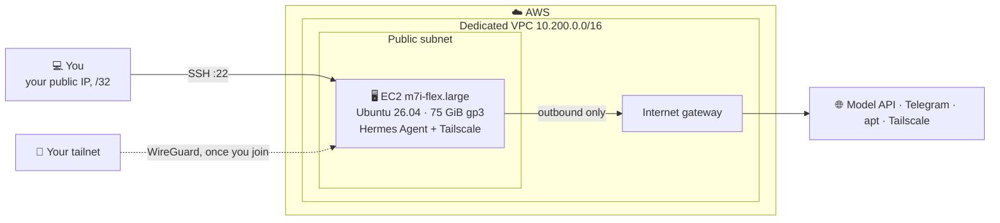

<div align="center">

# Hermes on AWS, in one `tofu apply`

**A locked-down, single-instance home for [Hermes Agent](https://github.com/NousResearch/hermes-agent):<br/>an always-on AI agent you can message from your phone.**


[Quick start](#quick-start) ·
[Architecture](#architecture) ·
[Set up Hermes](#set-up-hermes) ·
[Tailscale](#tailscale-and-locking-ssh-down) ·
[Configuration](#configuration) ·
[Security](#security-model) ·
[Troubleshooting](#troubleshooting)

</div>

---

## What you get

One `tofu apply` gives you a ready-to-configure box, with no clicking around the console:

| | |
|---|---|
| **Hermes Agent**, pre-installed | Installed for the `ubuntu` user with the official installer in non-interactive mode. Installed, **not configured**: you choose the provider, model and chat platform. |
| **Tailscale**, pre-installed | Installed and running, **not joined**, so you can reach the box privately and close public SSH entirely. |
| **A dedicated VPC** | One public subnet, an internet gateway, a route table. Works in accounts that have no default VPC. **No NAT gateway**, so nothing expensive hiding in the bill. |
| **One inbound rule** | SSH (TCP 22) from the public IP of the machine running `tofu`, as a single `/32`. Nothing else. |
| **Sensible host hardening** | IMDSv2 only, encrypted gp3 root volume, and no IAM role, so there are no AWS credentials on the box to steal. |

> [!NOTE]
> Defaults: Ubuntu 26.04 LTS, `m7i-flex.large` (2 vCPU / 8 GiB), 75 GiB gp3, region `eu-central-1`. All overridable, see [Configuration](#configuration).

## Architecture



Hermes only makes **outbound** connections (to your model provider and to chat platforms; Telegram uses long polling by default), so the security group needs no inbound rule for it.

<details>
<summary><b>Resources created (10)</b></summary>

| Resource | Purpose |
|---|---|
| `aws_vpc` | Dedicated VPC (`10.200.0.0/16`) |
| `aws_subnet` | One public `/24`, in an AZ that offers the instance type |
| `aws_internet_gateway` | Outbound internet, free |
| `aws_route_table` + `aws_route_table_association` | Default route `0.0.0.0/0` to the internet gateway |
| `aws_security_group` | Attached to the instance |
| `aws_vpc_security_group_egress_rule` | Allow all outbound |
| `aws_vpc_security_group_ingress_rule` | **The only inbound rule:** TCP 22 from your `/32` |
| `aws_key_pair` | From the public key you supply |
| `aws_instance` | The Hermes box, with the first-boot bootstrap as `user_data` |

</details>

## Prerequisites

- [OpenTofu](https://opentofu.org) 1.6 or newer
- AWS credentials for the target account (an SSO or named profile is fine)
- An SSH key pair; only the **public** key is given to AWS

## Quick start

```sh
# 1. Point at the right AWS account, and check you are in it
export AWS_PROFILE=<your-profile>
aws sts get-caller-identity

# 2. Hand OpenTofu your SSH *public* key through the environment
export TF_VAR_ssh_public_key="$(cat ~/.ssh/id_ed25519.pub)"

# 3. Plan, read it, apply
tofu init
tofu plan -out=tfplan
tofu apply tfplan
```

A healthy plan shows **10 to add**: exactly one SSH ingress rule, no IAM resources, no NAT gateway.

> [!TIP]
> Prefer files over environment variables? Copy `terraform.tfvars.example` to `terraform.tfvars` (git-ignored) and fill it in. Values in `terraform.tfvars` win over `TF_VAR_*` variables.

> [!IMPORTANT]
> The security group opens SSH to the IP the plan was made from. If you change network (home, office, VPN on/off), run `tofu apply` again from the new network to update the rule.

## Connect

```sh
tofu output ssh_command                 # prints: ssh ubuntu@<public_ip>
ssh -i ~/.ssh/id_ed25519 ubuntu@<public_ip>
```

The first boot installs packages for a few minutes. Watch it with:

```sh
cloud-init status --wait
tail -f /var/log/cloud-init-output.log
```

## Set up Hermes

Hermes is installed but unconfigured. As the `ubuntu` user (a fresh login shell, so `hermes` is on your `PATH`):

```sh
hermes setup             # provider, model, API key
hermes gateway setup     # connect a chat platform
hermes gateway install   # run the gateway as a service, so it survives logout
```

Then just run `hermes` in a project directory to chat in the terminal.

> [!WARNING]
> Always set a **user allowlist** for your chat platform (for Telegram, `TELEGRAM_ALLOWED_USERS=<your numeric user id>`). The agent has a terminal on this machine. Hermes denies unlisted users by default; never override that.

**Telegram notes**
- Messages arrive by **long polling** (the default), which is outbound-only. Do not enable webhook mode; it needs an inbound HTTPS port that this security group does not open.
- Telegram cloud chats, which bots use, are **not end-to-end encrypted**; Secret Chats are, but a bot cannot use them. Keep API keys and secrets out of chat and enter them over SSH. Hermes also supports Signal, which is end-to-end encrypted but needs a phone number and `signal-cli`.

## Tailscale and locking SSH down

Tailscale is installed and its daemon runs, but the node is **not joined**: joining needs an auth key, and secrets do not belong in `user_data`. Join once, interactively:

```sh
sudo tailscale up --ssh
```

Open the printed URL to approve the node. To then close public SSH completely, so the security group has **no inbound rules at all**:

1. **Test first** from another device on your tailnet, using the node's tailnet name (`tailscale status`) or its `100.x` address (`tailscale ip -4` on the instance):

   ```sh
   ssh ubuntu@<tailnet-name-or-100.x-address>
   ```

2. **Only when that works**, set `ssh_allow_current_ip = false` in `terraform.tfvars`.
3. `tofu plan -out=tfplan` should show exactly one change (the SSH rule being destroyed). Then `tofu apply tfplan`.
4. **Check** from a machine outside your tailnet: `ssh ubuntu@<public_ip>` should now time out; the tailnet address still works.

> [!CAUTION]
> There is no SSM Session Manager and no other way in. If Tailscale is down and public SSH is closed, you are locked out. Recovery is easy and needs no access to the box: set `ssh_allow_current_ip = true` again and run `tofu apply` from the machine you want to SSH from.

## Configuration

Set variables with `terraform.tfvars`, `-var`, or `TF_VAR_<name>` environment variables.

| Variable | Default | Description |
|---|---|---|
| `region` | `eu-central-1` | AWS region |
| `aws_profile` | `null` | AWS profile; `null` uses the default credential chain (`AWS_PROFILE`) |
| `name` | `hermes` | Name prefix for all resources |
| `instance_type` | `m7i-flex.large` | EC2 instance type |
| `root_volume_size_gb` | `75` | Root volume size (GiB, encrypted gp3) |
| `ubuntu_version` | `26.04` | Ubuntu LTS release; use `24.04` if a dependency does not support 26.04 yet |
| `vpc_cidr` | `10.200.0.0/16` | CIDR of the VPC this creates; the subnet is its first `/24` |
| `ssh_allow_current_ip` | `true` | Open SSH to the IP `tofu` runs from; `false` removes all inbound rules |
| `ssh_public_key` | `null` | Public key to register as an EC2 key pair (login user: `ubuntu`) |
| `ssh_key_name` | `null` | Alternative to `ssh_public_key`: name of an existing key pair |
| `user_data` | `null` | Extra shell snippet appended after the built-in bootstrap |
| `tags` | `Project`, `Environment`, `ManagedBy` | Tags applied to every resource |

**Outputs:** `instance_id`, `public_ip`, `ami_id`, `ssh_command`.

<details>
<summary><b>What the first-boot bootstrap does</b></summary>

Runs once through cloud-init as root, in this order (so a failed Hermes install cannot block Tailscale):

1. `apt-get install` of `ca-certificates curl git libatomic1 tar` (the Hermes installer needs them; minimal Ubuntu images lack `libatomic1`)
2. Adds Tailscale's official apt repository for the running Ubuntu codename and installs `tailscale`
3. Downloads the Hermes installer and runs it as `ubuntu` with `--non-interactive`, which skips the setup wizard and the gateway service install

Your own `user_data`, if set, is appended after these steps.

</details>

## Security model

| Layer | Control |
|---|---|
| **Network** | One inbound rule: TCP 22 from a single `/32`, looked up at plan time. A postcondition refuses anything that is not a public IPv4 address. All outbound allowed; no other inbound. |
| **Host** | IMDSv2 required, encrypted root volume, **no IAM role or instance profile** (no AWS credentials on the box, no SSM). |
| **Access** | Key-pair SSH as `ubuntu`, then optionally Tailscale and closing public SSH entirely. |
| **Agent** | Hermes denies unlisted chat users by default; dangerous commands need approval (`approvals.mode`), and unattended runs default to deny. |

**Known limitations**
- **Local state.** `terraform.tfstate` stays on your machine (git-ignored). Add a remote backend before using this beyond a personal sandbox.
- **Unpinned installer.** Hermes (and Tailscale's repo) are fetched at first boot, so you get whatever is current.
- **Public IP is not fixed.** It changes when the instance is stopped and started. Attach an Elastic IP if you need it stable.
- **Prompts leave AWS.** Whatever you send the agent goes to your chosen model provider and chat platform.

## Costs

Money is spent on the **EC2 instance** (the big one), the **75 GiB volume**, and the **public IPv4 address**. The VPC, subnet, internet gateway, route table and security group are free, and there is **no NAT gateway**. Check current prices for your region before leaving it running.

## Day-2 operations

| Task | How |
|---|---|
| **My IP changed** | Run `tofu apply` again from the new network. |
| **Bigger instance** | Change `instance_type` and apply. The instance stops and starts, and the public IP changes. |
| **Bigger disk** | Raise `root_volume_size_gb` and apply (volumes can grow, never shrink). Reboot so cloud-init grows the filesystem, then check with `df -h`. |
| **Switch Ubuntu release** | Changing `ubuntu_version` does not replace a running instance (the AMI is ignored after creation). Recreate with `tofu apply -replace=aws_instance.this` (this wipes the disk, so back up anything you need first). |
| **Tear it all down** | `tofu destroy`. This deletes the instance **and its disk**, including all Hermes memory, sessions and config. |

## Troubleshooting

| Symptom | Likely cause and fix |
|---|---|
| `ExpiredToken` or `profile could not be found` | AWS credentials expired or the profile name changed. Refresh them, then check `aws sts get-caller-identity`. |
| Plan fails: *no key to log in with* | Set `TF_VAR_ssh_public_key` (or `ssh_public_key`, or `ssh_key_name`). |
| Plan fails: *did not return a public IPv4 address* | The IP lookup returned IPv6 or something odd (some VPNs and proxies). Try another network, or see the Tailscale section before setting `ssh_allow_current_ip = false`. |
| Plan fails: *No availability zone … offers* | The instance type is not offered in the region. Pick another `instance_type` or `region`. |
| SSH times out | Your public IP changed: run `tofu apply` again from where you are. Or the bootstrap is still running. |
| `hermes: command not found` | Open a new login shell; the installer edits your shell rc files. |
| Bootstrap seems to have failed | `cloud-init status --long` and `/var/log/cloud-init-output.log`. If a package or installer does not support Ubuntu 26.04 yet, set `ubuntu_version = "24.04"`. |
| Bot does not reply | Is the gateway running (`hermes gateway start`)? Is your numeric user id in the allowlist? Is webhook mode accidentally enabled? |

## Project layout

| File | Contents |
|---|---|
| `versions.tf` | OpenTofu and provider versions, AWS provider config |
| `variables.tf` | All inputs, with validation |
| `main.tf` | VPC, security group, key pair, instance, bootstrap script |
| `outputs.tf` | Instance ID, public IP, AMI, SSH command |
| `terraform.tfvars.example` | Template for your local `terraform.tfvars` (git-ignored) |
| `.terraform.lock.hcl` | Pinned provider versions; commit it |

## License

See [LICENSE](LICENSE).
